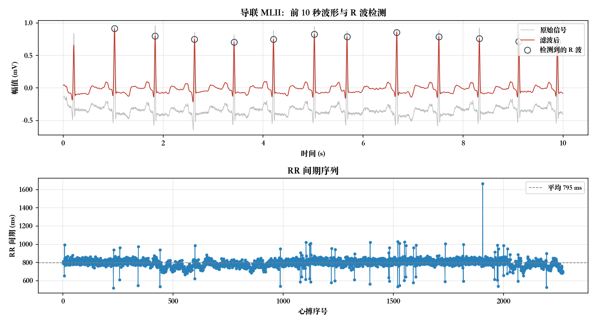

# 心电图智能体

**ECG Agent: an LLM agent that reads electrocardiograms — every number traced to a tool call**

> 一个大模型负责调度、本地工具负责计算的医学智能体：LLM 决定调哪个工具、把结果翻译成临床判读，**所有数值都来自工具返回值，模型不允许自己产生数字**。

[](LICENSE)
[](https://www.python.org/)
[](https://physionet.org/content/mitdb/1.0.0/)

- 🌐 **中英双语界面** —— 界面文案、图表标签、智能体回答、工具描述全部随语言切换
- 📖 **使用说明**：[`使用说明.md`](使用说明.md)
- 🫀 **上传自己的心电** —— 支持实验设备导出的单列 CSV
- 🔍 **过程完全透明** —— 每次工具调用的参数与返回的原始 JSON 都可见

---

## 效果预览

<!--
界面截图放这里。跑起来后截三张，存到 assets/ 目录，然后取消下面的注释：


-->

程序生成的波形图与 R 波检测：



---

## 为什么不做成"接个大模型直接问"

把心电图直接丢给多模态大模型问"这是什么心律"，能得到流畅的回答，但你没有理由相信它——它可能把 QRS 说成 T 波，也可能凭空编出一个心率数字，而你无从分辨。

**医学场景里，"看起来对"和"可核查"是两回事。**

这个项目把职责切开：

| 谁 | 负责什么 |
|---|---|
| **大模型** | 决定下一步调哪个工具、参数填什么；把工具返回的数值翻译成规范的临床判读；回答追问 |
| **本地工具** | 全部医学计算：滤波、R 波检测、心率与 HRV、逐搏分类、危急值查询 |

系统提示里写死了三条约束：**所有数值只能来自工具返回值**、发现异常必须查指南原文、结尾必须声明需医生复核。工具报错时模型不会编数据，而是如实报告"该项缺失"。

结果是：每一句结论都能回溯到一次具体的工具调用和它返回的 JSON。

## 架构

```
                        ┌──────────────────────────┐
   医生提问  ──────────► │  LLM（任意 OpenAI /     │
                        │  Anthropic 兼容接口）    │
                        └───────────┬──────────────┘
                                    │ tool_call
                        ┌───────────▼──────────────┐
                        │  主循环（约 50 行）       │
                        │  执行工具 → 结果塞回上下文 │
                        └───────────┬──────────────┘
                                    │
     ┌──────────────┬───────────────┼───────────────┬──────────────┐
     ▼              ▼               ▼               ▼              ▼
 list_records  check_quality    measure        classify     lookup_guideline
                                心率 / 心律     逐搏分类      危急值条目
                                HRV            随机森林      指南原文
```

**五个工具**就是五个普通 Python 函数。换成别的模型、别的厂商，工具层一行都不用改。

## 快速开始

```bash
git clone https://github.com/Muhan-Qiu/ecg-agent.git
cd ecg-agent
pip install -r requirements.txt

streamlit run app.py          # 网页界面
python3 ecg_agent.py "记录 208 需要立即转诊吗？"    # 命令行
```

浏览器打开 `http://localhost:8501`。

**大模型怎么配**：界面右上角 ⚙ 模型 里选厂商、填 API Key，点"应用并测试"当场验证。内置 10 个厂商预设（DeepSeek / OpenAI / Anthropic / Moonshot / 智谱 / 通义 / MiniMax / 本地 Ollama / 自定义）。默认走本机代理，不需要 key。

> API Key 只保存在会话内存里，不写文件、不进日志、不回显。

## 性能

分类器在 **MIT-BIH 心律失常数据库**上训练，采用 de Chazal (2004) 的**标准 inter-patient 划分**（DS1 22 条训练，DS2 22 条测试）——训练集与测试集来自**不同患者**，这才是真实场景下的性能，不是随机划分刷出来的虚高数字。

**DS2 测试集，48 751 个心搏：**

| 类别 | 精确率 | 召回率 | F1 |
|---|---|---|---|
| N 正常搏动 | 0.948 | 0.994 | **0.971** |
| S 室上性异位 | 0.686 | 0.039 | 0.074 |
| V 室性异位 | 0.935 | 0.904 | **0.919** |
| F 融合搏动 | 0.033 | 0.008 | 0.013 |
| **总体准确率** | | | **94.5%** |

## 已知局限（这一节比上一节更重要）

**S 类召回率只有 3.9%，这是方法的固有短板，不是调参能解决的。**

我做过特征消融实验来确认这一点：

| 使用的特征 | S 召回 | V 召回 | 总体准确率 |
|---|---|---|---|
| 仅 RR 间期特征 | 0.070 | 0.755 | 0.918 |
| 仅波形形态特征 | 0.008 | 0.816 | 0.927 |
| 全部特征 | 0.039 | 0.904 | 0.945 |

原因是：**室上性异位搏动的 QRS 形态与正常搏动几乎相同**，判别它靠的是 P 波的出现时机（提前出现的异位 P' 波、或 P 波缺如）。而这套特征里只有 RR 间期和 QRS 形态，**没有任何 P 波信息**。文献中该类的召回率也普遍偏低。

F 类（融合搏动）同理，且全库仅 803 个样本，本身就不足以训练。

**其他边界：**

- 模型输出是**算法初筛**，不能直接用于临床，必须经医生复核
- 上传自己的数据时，若导联与 MIT-BIH 的 MLII 不同（尤其极性相反），分类结果会明显下降；**心率、心律规整性、HRV 不受影响**，它们是时间域的量
- 运动状态下的记录会因肌电干扰导致 R 波漏检，被误判为"心律不齐"——这是信号质量问题，不是真实心律失常
- 智能体有 6 步上限，超过会中止并说明

## 数据来源

- **MIT-BIH 心律失常数据库**（44 条记录，103 724 个心搏）
  PhysioNet: <https://physionet.org/content/mitdb/1.0.0/>
  许可：Open Data Commons Attribution License v1.0 (ODC-BY 1.0)
- **指南**：[`guideline.md`](guideline.md) 摘自《心电图危急值 2017 中国专家共识》
  （中国心电学会危急值专家工作组，《临床心电学杂志》2017 年第 26 卷第 6 期）

界面支持上传实验设备导出的单列 CSV（12 位 ADC 原始计数）。**上传的文件被 `.gitignore` 排除，不会进入版本库。**

## 文件结构

```
ecg_tools.py         工具集：读取、CSV 导入、质量检查、滤波、R 波检测、测量、分类、指南查询
ecg_agent.py         智能体本体：工具表 + 工具描述 + 主循环 + 多厂商接入
app.py               Streamlit 界面（中英双语）
train_classifier.py  训练心搏分类器
guideline.md         危急值指南条目
models/              训练好的分类器
data/                MIT-BIH 记录
```

## 许可

代码以 [MIT License](LICENSE) 发布。
使用的数据遵循其原始许可（MIT-BIH 为 ODC-BY 1.0），再分发时请保留署名。

---

<sub>重庆大学 生物医学工程 · 医学人工智能原理与应用 课程项目</sub>
