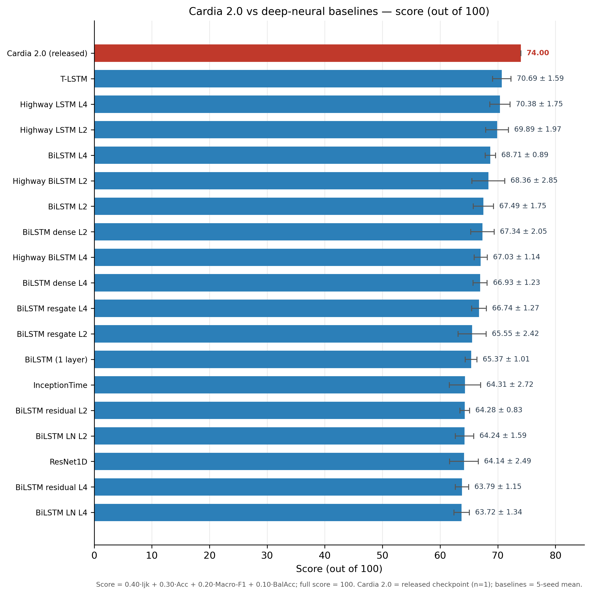
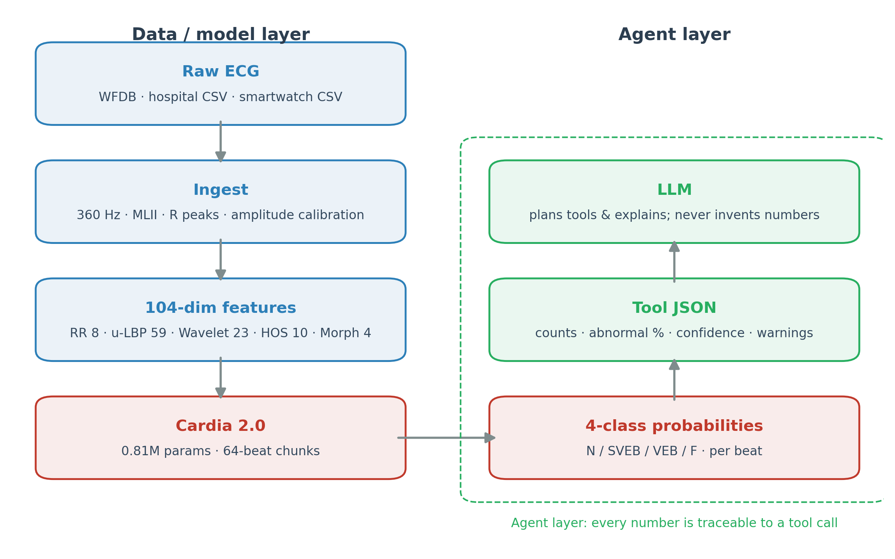

# 心电图智能体（ECG Agent）· v2.0

**Cardia 2.0: ECG-specific beat classification with traceable tool calls**

**中文**（本文件） ｜ **English**: [`README.en.md`](README.en.md)

---

## 1. 项目简介

心电图智能体是一个将大语言模型与本地心电分析工具结合的开源项目。LLM 负责选择工具、
组织解释；本地工具负责信号质量检查、R 峰检测、心率与 HRV、逐搏分类和危急值查询。
所有数值来自工具返回值，可追溯。

当前版本 **v2.0** 使用自研 **Cardia 2.0** 逐搏分类器；**v1.0** 使用随机森林分类器。

## 2. 版本历史

| 版本 | 分类器 | 主要变化 |
|---|---|---|
| v1.0 | 随机森林（49 维，逐搏独立） | 初版；5 个本地工具；中英双语界面；上传单列 CSV |
| v2.0 | Cardia 2.0（104 维，64-beat 序列） | 自研模型；综合评分 74.00/100；模型卡；上传实验路径 |

- V1.0 代码与原始 README：<https://github.com/Muhan-Qiu/ecg-agent/tree/v1.0.0>
- V1.0 说明摘要：[`docs/v1-legacy.md`](docs/v1-legacy.md)

## 3. v2.0 更新与 Cardia 2.0

**v2.0 更新**：逐搏分类器由随机森林替换为自研 **Cardia 2.0**；在测试集
（de Chazal DS2）上的综合评分为 **74.00（满分 100）**。

Cardia 2.0 是本项目自研的心电逐搏分类模型，基于 104 维心搏特征与 64-beat 序列，
输出 N / SVEB / VEB / F 四类概率。

### 3.1 设计动机（概述）

现有多层双向循环网络（如多层 BiLSTM）在层间同时传递前向与后向状态。随着层数增加，
每一层都会混合来自两个方向的信息，推理阶段“当前时刻可见的信息边界”变得不清晰；
对于逐搏心电分析，这种双向混合既不利于在线推理，也增加了判读解释的难度。另一方面，
深层循环网络若缺少跨层捷径，信息与梯度在多层传递中容易衰减；直接加深网络又会显著
增加参数量，在小规模心电数据上加重过拟合。

### 3.2 设计目标（概述）

Cardia 2.0 的设计围绕三个目标展开：

1. **保持推理阶段的信息单向性**：不依赖未来心搏的信息，使逐搏判读的因果边界清晰。
2. **改善深层序列建模的稳定性**：为多层状态更新提供更直接的跨层信息路径，避免单纯
   叠加层数带来的信息衰减。
3. **控制模型规模与种子方差**：在不显著增加参数量的前提下，提升多层序列建模的稳定性
   与少数类判别能力。

> 本节只描述设计动机与目标。具体的层间连接方式、门控形式、状态更新规则、训练策略、
> checkpoint 选择准则与特征/模型协同设计不在公开材料中展开；公开权重以 ONNX /
> TorchScript 推理格式提供，预处理契约见 `models/cardia/preprocess.json`。

## 4. 综合评分（满分 100）

下表为 Cardia 2.0 与 18 个深层神经网络基线在测试集上的综合评分。所有模型使用相同的
104 维特征与 de Chazal DS1/DS2 划分；基线为 5-seed 均值。

| 模型 | n | 综合评分（满分 100） |
|---|---:|---:|
| **Cardia 2.0 (released)** | 1 | **74.00** |
| T-LSTM | 5 | 70.69 ± 1.59 |
| Highway LSTM L4 | 5 | 70.38 ± 1.75 |
| Highway LSTM L2 | 5 | 69.89 ± 1.97 |
| BiLSTM L4 | 5 | 68.71 ± 0.89 |
| Highway BiLSTM L2 | 5 | 68.36 ± 2.85 |
| BiLSTM L2 | 5 | 67.49 ± 1.75 |
| BiLSTM dense L2 | 5 | 67.34 ± 2.05 |
| Highway BiLSTM L4 | 5 | 67.03 ± 1.14 |
| BiLSTM dense L4 | 5 | 66.93 ± 1.23 |
| BiLSTM resgate L4 | 5 | 66.74 ± 1.27 |
| BiLSTM resgate L2 | 5 | 65.55 ± 2.42 |
| BiLSTM (1 layer) | 5 | 65.37 ± 1.01 |
| InceptionTime | 5 | 64.31 ± 2.72 |
| BiLSTM residual L2 | 5 | 64.28 ± 0.83 |
| BiLSTM LN L2 | 5 | 64.24 ± 1.59 |
| ResNet1D | 5 | 64.14 ± 2.49 |
| BiLSTM residual L4 | 5 | 63.79 ± 1.15 |
| BiLSTM LN L4 | 5 | 63.72 ± 1.34 |

### 综合评分方式

**综合评分 = 0.40·Ijk + 0.30·Acc + 0.20·Macro-F1 + 0.10·BalAcc**，满分 100。

其中 Ijk 使用修正后的 AAMI 评测口径（V 类 FP 取 `conf_mat[3][2]`），Acc 为总体准确率，
Macro-F1 为四类 F1 的算术平均，BalAcc 为四类召回的平均。

> 发布行为单 checkpoint；同配置 5-seed 均值为 **70.02（满分 100）**。
> 数据见 [`docs/benchmark/score_table.csv`](docs/benchmark/score_table.csv)。



> 全部基线按综合评分排序；Cardia 2.0 为红色。基线为 5-seed 均值，发布行为单 checkpoint。

## 5. 评测协议

| 项 | 设置 |
|---|---|
| 数据 | MIT-BIH Arrhythmia Database |
| 划分 | de Chazal (2004) inter-patient：DS1 22 条训练，DS2 22 条测试 |
| 类别 | AAMI 四类：N / SVEB / VEB / F |
| 输入 | MLII 数字量，360 Hz；两次中值滤波；R 峰 ±20 局部最大；±90 窗 |
| 特征 | 104 维：RR 8 + u-LBP 59 + Wavelet 23 + HOS 10 + myMorph 4 |
| 切块 | 每条记录内 64 beat 非重叠 chunk |
| 选模 | DS1 3-fold 验证集，`Kappa + 0.25·SVEB recall`（3-epoch 平滑） |
| 测试集 | 只评一次，未用于调参或选模 |
| 基线 | 同一套 104 维特征、同一划分；5-seed 均值 |

## 6. 系统架构



系统分为数据/模型层与 Agent 层：

- **数据/模型层**：原始 ECG 经统一预处理得到 104 维特征，按记录内 64-beat 非重叠 chunk
  送入 Cardia 2.0，输出每搏四类概率。
- **Agent 层**：本地工具将分类结果、测量值、质量检查与指南条目组织为 JSON；
  大模型仅负责选择工具、组织解释，不生成数值。
- **可追溯性**：所有数值来自工具返回值，每次工具调用的参数与原始 JSON 均可在界面中展开。

### 工具

| 工具 | 作用 |
|---|---|
| `list_records` | 列出可分析记录 |
| `check_quality` | 导联脱落、伪差、高频噪声 |
| `measure` | 心率、心律规整性、HRV |
| `classify` | 逐搏四类分类；`engine=auto/v2/fallback` |
| `lookup_guideline` | 危急值指南原文 |
| `model_info` | 模型卡：参数量、综合评分、适用范围 |

## 7. 快速开始

```bash
git clone https://github.com/Muhan-Qiu/ecg-agent.git
cd ecg-agent
pip install -r requirements.txt

# 下载 MIT-BIH（默认 data/；数据不提交进 git）
python scripts/download_mitbih.py

streamlit run app.py
```

浏览器打开 `http://localhost:8501`。

**命令行**

```bash
python ecg_agent.py "分析记录 208，是否存在危急情况？"
python -c "import ecg_tools as T; print(T.classify_beats('208', engine='v2'))"
```

**复现基准与图**

```bash
python scripts/benchmark_ds2.py --v2
python scripts/make_plots.py
```

**大模型配置**：界面右上角 ⚙ 模型 中选择厂商、填写 API Key，点击“应用并测试”验证。
内置 10 个厂商预设（DeepSeek / OpenAI / Anthropic / Moonshot / 智谱 / 通义 / MiniMax /
本地 Ollama / 自定义）。API Key 仅保存在会话内存中，不写入文件、不进入日志、不回显。

## 8. 模型规模与运行时间

| 项 | Cardia 2.0 |
|---|---:|
| 参数量 | 809,332 |
| 权重体积 | ONNX 5.6 MB / TorchScript 3.6 MB |
| 输入 | 104 维/搏 × 64 搏 |
| 上下文 | 64-beat 序列 |
| CPU 推理 | 约 2–4 s / 条 30 分钟记录（TorchScript，已预热） |

> ONNX 图约 2.4 万个节点，ONNX Runtime 首次建立会话在部分 Windows 环境下约需 1 分钟；
> TorchScript 加载约 2 秒。应用默认优先使用 TorchScript，未安装 PyTorch 时回退 ONNX。

## 9. 上传与格式

支持带元数据头的单列 CSV（已使用 Samsung Galaxy Watch 导出验证）：

```text
名称,示例用户
采样率,500.000 Hz
导联,Lead I
单位,mV

-0.108716
-0.10939
...
```

处理流程：

1. 跳过非数值头，读取采样率、导联与单位元数据；
2. 重采样至 360 Hz；
3. 自动检测 R 峰；
4. 幅度校准至 MIT-BIH 数字量级；
5. 可选手动反转极性；
6. 运行 Cardia 2.0，结果标记 `experimental=true`。

> Cardia 2.0 在 MLII、360 Hz 数据上训练；其他导联、采样率与设备增益属于域外输入。
> 30 秒手表记录通常不足 64 搏，系统会零填充至 64 搏并标记 `padded=true`。
> 多格式自动接入（WFDB、EDF、SCP-ECG、HL7 aECG、DICOM 等）见
> [`docs/roadmap.md`](docs/roadmap.md)。

## 10. 适用范围与限制

1. 本系统为科研与教学用途，不是医疗器械，不能用于临床诊断、分诊或治疗决策。
2. 模型仅在 MIT-BIH 单一数据集、de Chazal DS1/DS2 单一划分上评测，尚无外部验证。
3. 模型在 MLII、360 Hz 数据上训练；更换导联、采样率或设备增益会产生域偏移。
4. 综合评分为整体指标，不替代逐类临床验证；完整逐类指标与混淆矩阵保存在内部评测记录中。

## 11. 数据与许可

- **MIT-BIH Arrhythmia Database**（44 条记录，约 10 万个心搏）
  PhysioNet: <https://physionet.org/content/mitdb/1.0.0/>
  许可：Open Data Commons Attribution License v1.0 (ODC-BY 1.0)。
- **指南**：[`guideline.md`](guideline.md)，摘自《心电图危急值 2017 中国专家共识》。
- **代码**：GPL-3.0，见 [`LICENSE`](LICENSE)。104 维特征管线的来源与修改说明见
  [`THIRD_PARTY_NOTICE.md`](THIRD_PARTY_NOTICE.md)。

## 12. 引用

如在学术工作中使用本仓库，请引用：

- de Chazal, P., O'Dwyer, M., & Reilly, R. B. (2004). Automatic classification of
  heartbeats using ECG morphology and heartbeat interval features. IEEE TBME.
- Mondejar-Guerra, V., et al. (2019). Heartbeat classification using disease-specific
  feature selection. Computers in Biology and Medicine.
- Goldberger, A., et al. (2000). PhysioBank, PhysioToolkit, and PhysioNet.
  Circulation, 101(23), e215–e220.
